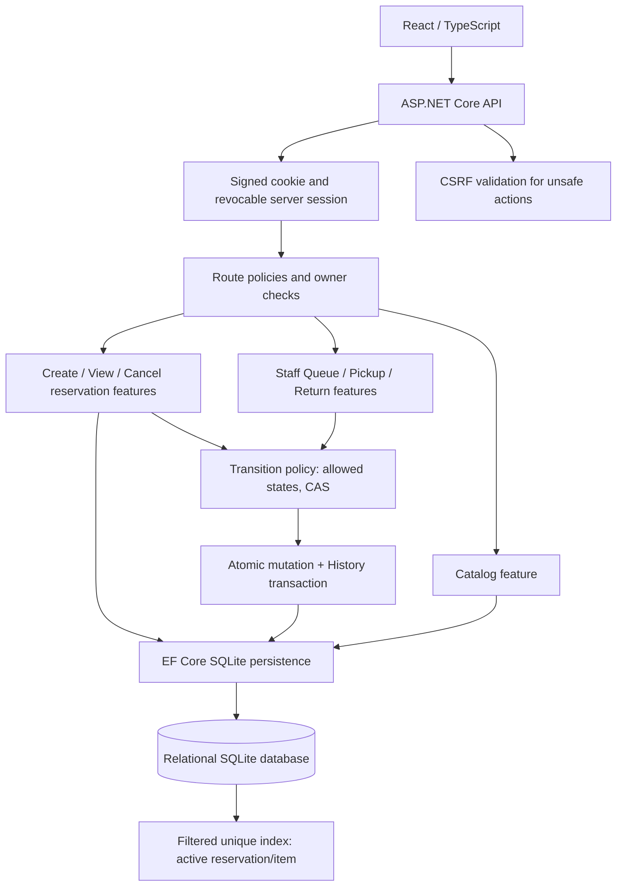

# CELD Group 4 — Architecture and responsibilities

## Module map

| Module | Responsibility | Source |
|---|---|---|
| Authentication | Seeded roles, password hashing, session cookie sign-in/out, server-side revocation | `Features/Authentication/`, `Security/` |
| Catalog | Public list/search/filter/detail and availability from live database | `Features/Catalog/CatalogEndpoints.cs` |
| Student reservations | Reserve item, read own reservations and history, cancel own Reserved | `Features/Reservations/` |
| Lending | Staff listing/status filters, pickup, return | `Features/Lending/LendingEndpoints.cs` |
| Shared lifecycle | `Domain/ReservationLifecycle.cs` validates legal transitions; `ReservationTransitions.cs` performs CAS updates and atomic History transaction | `Domain/ReservationLifecycle.cs`; `Features/Reservations/ReservationTransitions.cs` |
| Persistence | Entity relationships, check constraints, filtered unique active-index and initial seed | `Data/` |
| Errors / CSRF | Consistent RFC 7807-style ProblemDetails, global anti-forgery checks | `Common/ApiErrors.cs`, `Program.cs` |

## Sequence: reserve

1. Student requests CSRF token and sends `POST /api/reservations {equipmentId}` with cookie and `X-CSRF-TOKEN`.
2. Cookie authentication revalidates the server-side session; route policy requires `Student`.
3. Create handler derives StudentId from session; validates item and availability.
4. Database enforces **unique filtered index**. Reservation and creation event are inserted in the same EF `SaveChanges` transaction.
5. On success API returns `201` and a persisted reservation; on expected double booking returns controlled `409`. UI refreshes catalog from API.

## Sequence: cancel / pickup / return

1. Cookie + CSRF + role policy checked. Cancellation also verifies ownership.
2. Handler loads current status and version, confirms the requested transition is legal.
3. Transaction begins; `ExecuteUpdateAsync` conditionally updates `WHERE id AND status AND version`.
4. If zero rows were updated, it returns `409` without adding a successful History Event.
5. Within the same transaction, the corresponding History Event is inserted; `COMMIT` occurs only after both operations succeed.
6. UI revalidates server state. Cancelled and Returned are terminal records that remain persisted.

## DB schema (simplified)

- `EquipmentItems`: `Id`, unique `AssetCode`, `Name`, `Category`, `Description`.
- `UserAccounts`: `Id`, unique uppercase email, display name, password hash, course role.
- `LoginSessions`: server-revocable session id, user FK, expiry, revoke flag.
- `Reservations`: ID, equipment FK, student FK, enum-like status string (CHECK), UTC created time, integer `Version`. UNIQUE filtered index `UX_OneActiveReservationPerItem` applies only to `Reserved` or `CheckedOut`.
- `HistoryEvents`: reservation FK, resulting status, event type, acting user FK, UTC time; view chronological order by time and ID.

**SRS limitation:** Does not mandate schema/availability storage strategy. This is an architectural choice, not a change in product requirements.
